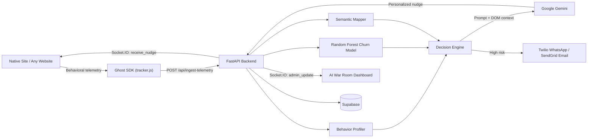

# Synaptic — Behavioral Intent Engine

> Real-time behavioral AI that spots when a user is frustrated, confused or about to leave, and steps in with a personalized, context-aware nudge. It works on our own platform and, through the Ghost SDK, on other websites too.

Synaptic watches *how* people use a website: rage clicks, scroll thrashing, hesitation, idle time and exit intent. A machine-learning model turns those signals into a churn-risk score and a behavioral profile. Google Gemini then writes an intervention that fits the page the user is on, and it reaches their screen in a couple of seconds.

---

## ✨ Key Features

| Feature | Description |
|---|---|
| **Native Wealth Platform** | Next.js client portal (Investments, Insurance, Retirement, Planning, Checkout/KYC) with built-in behavioral tracking |
| **Universal Ghost SDK** | A small JS tracker you can inject into other websites (bookmarklet / Tampermonkey) to capture friction signals across domains |
| **Behavioral Profiling** | Puts each session into one of 7 profiles: `BLOCKED`, `STRUGGLING`, `CONFUSED`, `HESITANT`, `DISENGAGING`, `EXPLORING`, `HIGH_INTENT` |
| **ML Churn Prediction** | A scikit-learn Random Forest scores churn probability in real time |
| **Semantic Mapper** | Reads the DOM of pages it hasn't seen before and maps them to funnel stages (Exploration → Planning → Application → KYC → Transaction) |
| **Context-Aware AI Nudges** | Gemini writes interventions using the page's live DOM context (title and headings) |
| **Real-Time Delivery** | Socket.IO pushes nudges to the browser instantly; a sync endpoint is used where CSP is strict |
| **AI War Room (Admin)** | Constellation map, live funnel, XAI explainability feed, session ghost, dispatch queue and manual "God Mode" nudges |
| **Escalation Cascade** | Sends WhatsApp (Twilio) and email (SendGrid) follow-ups for high-risk sessions |
| **AI Chatbot** | In-app assistant backed by a knowledge base |

---

## 🏗️ Architecture



---

## 🧰 Tech Stack

| Layer | Technology |
|---|---|
| Frontend | Next.js 14, React 18, Tailwind CSS, Framer Motion |
| Tracking SDK | Vanilla JavaScript (bookmarklet / Tampermonkey) |
| Backend | FastAPI, Uvicorn, python-socketio |
| AI / LLM | Google Gemini (`google-genai`), Groq |
| Machine Learning | scikit-learn (Random Forest), pandas, joblib |
| Database | Supabase |
| Auth | JWT (`python-jose`, `passlib`/bcrypt) |
| Notifications | Twilio (WhatsApp), SendGrid (Email) |

---

## 📁 Project Structure

```
.
├── frontend/                 # Next.js app (client portal + admin war room)
│   ├── app/                  # Routes: /, /investments, /insurance, /checkout, /admin/*
│   ├── components/           # Consumer + admin UI components
│   ├── contexts/             # Socket.IO context
│   ├── hooks/                # React tracker hook
│   ├── services/             # API + auth clients
│   └── public/
│       ├── tracker.js        # Universal Ghost SDK
│       └── bookmarklet.html  # Bookmarklet generator for external sites
├── our_backend/              # FastAPI backend
│   ├── main.py               # API routes + Socket.IO server
│   ├── processor.py          # Behavioral profiling & scoring
│   ├── brain.py              # Gemini prompt engineering / nudge generation
│   ├── semantic_mapper.py    # DOM → funnel-stage classification
│   ├── notifications.py      # Twilio / SendGrid escalation
│   ├── database.py           # Supabase persistence
│   ├── auth.py               # JWT authentication
│   ├── ml/train_model.py     # Random Forest training script
│   └── churn_predictor.pkl   # Trained model
├── run_all.ps1               # One-shot launcher (Windows)
├── README_SETUP.md           # Detailed beginner setup guide
└── TECHNICAL_DOCS.md         # In-depth technical documentation
```

---

## 🚀 Quick Start

### Prerequisites
- Node.js 18+ (LTS)
- Python 3.10+
- A Google Gemini API key
- *(Optional)* Supabase project, Twilio and SendGrid accounts, ngrok for external-site demos

### 1. Clone
```bash
git clone https://github.com/tanishksinha/Fidelity_CodeVerse.git
cd Fidelity_CodeVerse
```

### 2. Backend
```bash
cd our_backend
python -m venv venv
# Windows
venv\Scripts\activate
# macOS / Linux
source venv/bin/activate

pip install -r requirements.txt
```

Create `our_backend/.env`:
```env
GEMINI_API_KEY=your_gemini_key
GROQ_API_KEY=your_groq_key
SUPABASE_URL=your_supabase_url
SUPABASE_KEY=your_supabase_key
JWT_SECRET_KEY=your_secret
SENDGRID_API_KEY=your_sendgrid_key
TWILIO_ACCOUNT_SID=your_twilio_sid
TWILIO_AUTH_TOKEN=your_twilio_token
TWILIO_WHATSAPP_NUMBER=whatsapp:+14155238886
```

Run it:
```bash
python main.py
# Backend runs on http://localhost:8080
```

### 3. Frontend
```bash
cd frontend
npm install
npm run dev
# Frontend runs on http://localhost:3000
```

Optionally set `NEXT_PUBLIC_BACKEND_URL` in `frontend/.env.local` (defaults to `http://localhost:8080`).

> **Windows shortcut:** `./run_all.ps1` sets up and launches both servers. Note that it uses absolute paths, so edit them to match your machine first.

For a full step-by-step walkthrough, see **[README_SETUP.md](README_SETUP.md)**.

---

## 👻 Using the Ghost SDK on External Websites

1. Expose the backend publicly: `npx ngrok http 8080`
2. Open `http://localhost:3000/bookmarklet.html`, paste your ngrok URL and drag the generated bookmarklet to your bookmarks bar.
3. Visit another website and click the bookmarklet. The tracker loads and starts collecting signals.
4. On sites with a strict Content Security Policy, use the Tampermonkey userscript. It goes through `GM_xmlhttpRequest` and the `/api/ingest-telemetry-sync` endpoint.

---

## 🔌 API Overview

| Method | Endpoint | Purpose |
|---|---|---|
| `POST` | `/api/ingest-telemetry` | Ingest behavioral telemetry (nudge delivered via Socket.IO) |
| `POST` | `/api/ingest-telemetry-sync` | Ingest telemetry and return the nudge synchronously (for CSP-restricted sites) |
| `POST` | `/api/register-identity` | Link a ghost session to a user identity |
| `GET`  | `/api/market-data` | Market ticker data |
| `POST` | `/api/chat` | AI chatbot |
| `GET`  | `/api/admin/users` | Tracked users |
| `GET`  | `/api/admin/funnel-stats` | Funnel stage statistics |
| `GET`  | `/api/admin/bounced-sessions` | Bounced / at-risk sessions |
| `POST` | `/api/admin/run-engine` | Run the decision engine manually |
| `POST` | `/api/admin/dispatch` | Dispatch interventions |
| `GET`  | `/api/admin/intervention-log` | Intervention history |

**Socket.IO events:** `receive_nudge`, `user_activity`, `admin_update`, `intervention_sent`, `manual_nudge`

---

## 🧠 Behavioral Profiles

| Profile | Signal Pattern |
|---|---|
| `BLOCKED` | Repeated rage clicks on a single element; no forward progress |
| `STRUGGLING` | Goal-oriented but hitting friction (1–2 rage clicks plus scroll thrash) |
| `CONFUSED` | Chaotic scrolling and scattered hovering with no clear direction |
| `HESITANT` | Long, careful hovers on one element; slow and risk-averse |
| `DISENGAGING` | Long time on the page with almost no activity |
| `EXPLORING` | Browsing many pages with little friction |
| `HIGH_INTENT` | Deep scrolling, focused behavior, close to converting |

---

## 📚 Documentation

- [README_SETUP.md](README_SETUP.md): beginner-friendly full setup guide
- [TECHNICAL_DOCS.md](TECHNICAL_DOCS.md): technical deep dive
- [person_2sdk_guide.md](person_2sdk_guide.md): Ghost SDK guide
- [synaptic_demo_vs_ppt.md](synaptic_demo_vs_ppt.md): demo and presentation guide

---

## 👤 Author

**Tanishk Sinha** and team, built for the CodeVerse Hackathon.
